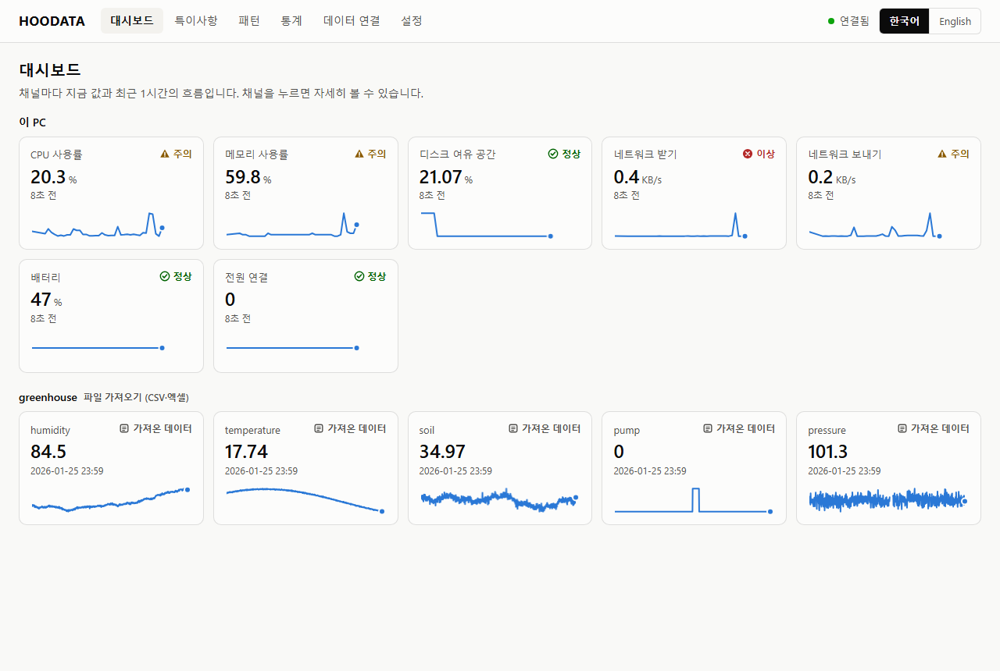
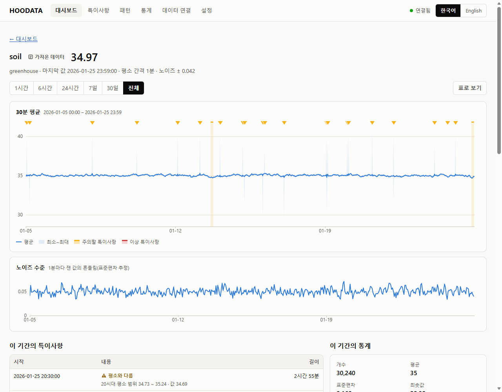
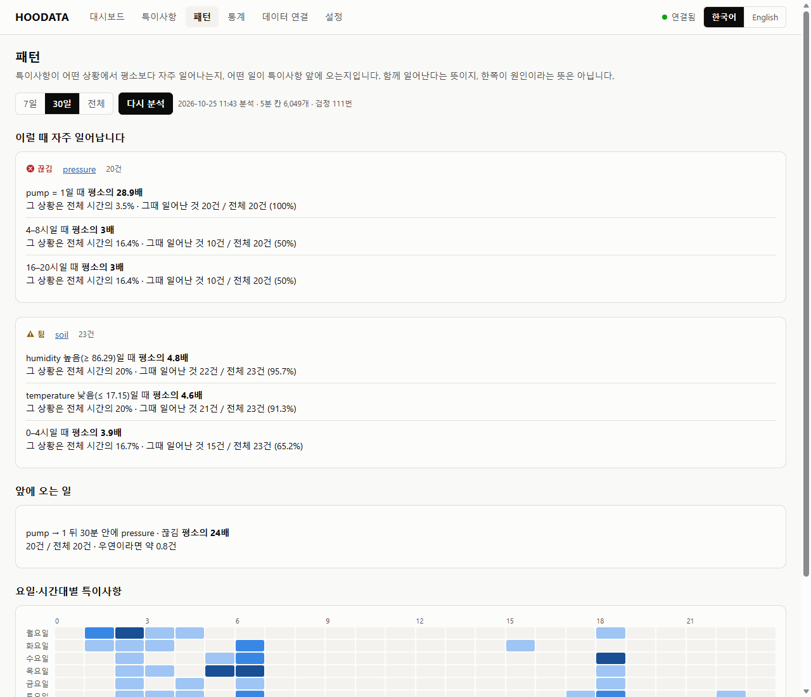

# HOODATA

**센서, 장치, 데이터 파일을 한 대시보드에서 지켜보고, 노이즈와 특이사항을 기록하고, 그것이 어떤 상황에서
일어나는지 찾아 줍니다.**

Windows 10/11 · 설치할 것 없음 · 모든 처리는 내 PC 안에서 · [Apache License 2.0](./LICENSE) ·
[English](./README.md)

특이사항과 패턴을 찾는 방법과 그 성능은 [docs/METHODS.md](docs/METHODS.md)(영어)에, 계획과 진행 상황은
[docs/ROADMAP.md](docs/ROADMAP.md)에 있습니다.

<p align="center"></p>

## 할 수 있는 일

- **모으기**: 이 PC(CPU, 메모리, 디스크, 네트워크, 배터리), CSV·엑셀 파일, 데이터로거가 계속 쓰는 폴더, HTTP로
  보내는 장치, MQTT 브로커, Modbus TCP 장치, 시리얼 포트(아두이노 텍스트, RS-485 Modbus RTU)에서 값을 받습니다.
- **보여 주기**: 채널마다 지금 값, 상태, 최근 값들을 보여 주는 실시간 대시보드. 아무 기간이나 확대해 보는
  그래프, 노이즈 수준, 통계. 모든 그래프는 표로도 볼 수 있습니다.
- **노이즈와 특이사항 기록**: 끊김, 튐, 수준 변화, 멈춤, 정한 범위 밖, 노이즈 증가, 그 시간대로는 평소와 다른 값.
  "튄 값 41.2 · 평소 35.0 · 평소 흔들림의 31배"처럼 그렇게 본 근거 숫자가 함께 남습니다. 괜찮은 것은 '괜찮음'으로
  표시하고, 목록은 CSV로 내려받습니다.
- **패턴 찾기**: 어떤 상황(시간대, 요일, 다른 채널이 높음·낮음, 펌프 켜짐·꺼짐)에서 특이사항이 평소보다 몇 배 자주
  일어나는지, 어떤 일이 그 바로 앞에 오는지를 근거와 우연 검정과 함께 보여 줍니다.

<p align="center"></p>

AI 모델이 아니라 이 저장소에서 직접 구현한 통계 방법을 쓰므로, 모든 결과에 그렇게 본 이유가 함께 나옵니다.
범용 엔진을 먼저 만들었고, 분야별 버전(스마트팜, 양식장, 공장 설비)은 그 위에 얹을 예정입니다.

## 시작하기

1. [Releases](https://github.com/WhoisHOO/HOODATA/releases)에서 **Source code (zip)**을 내려받습니다. 압축을
   풀기 전에 ZIP 파일을 마우스 오른쪽 버튼으로 눌러 **속성** → **차단 해제**를 체크하고 **확인**을 누릅니다(스마트 앱
   컨트롤이 켜져 있으면 이렇게 해야 `start.bat`이 실행됩니다).
2. 내 사용자 폴더(다운로드, 문서, 바탕 화면)에 압축을 풀고 **`start.bat`**을 더블클릭합니다(`C:\` 바로 아래 폴더는
   이 PC의 다른 사용자도 고칠 수 있습니다). 작은 HOODATA 창이 뜨고 브라우저에 대시보드가 열립니다. 몇 초 안에 이
   PC의 값이 나타납니다.
3. **데이터 연결**에서 CSV·엑셀 파일을 끌어다 놓거나 장치를 추가합니다.

HOODATA는 창이 열려 있는 동안 데이터를 모읍니다. 창을 내려 두어도 계속 모으고, 닫으면 멈춥니다. 데이터는
`start.bat` 옆의 `data` 폴더에 내 Windows 계정만 열 수 있게 저장되고, 어느 폴더를 쓰는지 HOODATA 창에 나옵니다. 그
폴더에 쓸 수 없거나(Program Files, 제어된 폴더 액세스로 보호되는 폴더) 다른 계정의 폴더이면
`%LOCALAPPDATA%\HOODATA\data`에 저장합니다. 복사하거나 백업에서 되살린 `data` 폴더도 그대로 씁니다.

처음 상태로 돌리려면 데이터 폴더를 지웁니다. HOODATA를 없애려면 HOODATA 폴더와, 있다면 `%LOCALAPPDATA%\HOODATA`,
`C:\ProgramData\HOODATA-temp-...`(사용자 이름이 영문이 아닐 때만 생기는 컴파일러 임시 폴더)를 지웁니다.

## 데이터 연결하기

| 종류 | 방법 |
|---|---|
| CSV·엑셀 파일 | 대시보드에 끌어다 놓습니다. 인코딩(UTF-8, 한국어 CP949, 이 PC의 기본 인코딩), 구분자, 소수점 쉼표, 머리글 줄, 시간 열(한국어 오전·오후, 날짜·시각이 따로인 열, 1970년부터의 초 포함), `온도(℃)` 같은 머리글의 단위를 알아봅니다. 가져오기 전에 값 열, 시간 열, 시간대, 시간 열이 없는 파일의 간격을 고릅니다. 엑셀은 `.xlsx`만 읽고(옛 `.xls`는 읽지 못함) 첫 번째 시트를 씁니다. |
| 폴더 | 데이터로거가 CSV 파일을 계속 쓰는 폴더. 새 파일과 새 줄을 2초마다 읽고, 다시 켜면 멈췄던 곳부터 이어 읽습니다. |
| HTTP | 같은 네트워크의 장치나 이 PC의 프로그램이 `http://<이 PC>:47110/ingest`로 열쇠와 함께 보냅니다. 화면에 주소, 열쇠, `curl`과 ESP32 예제가 나옵니다. |
| MQTT | 브로커의 주제를 구독합니다(필요하면 TLS, 사용자 이름·비밀번호). 주제마다, JSON 메시지는 항목마다 채널이 됩니다. |
| Modbus TCP | PLC나 계측기를 정해진 간격마다 레지스터 표대로 읽습니다: 영역, 주소, 16·32비트 정수나 실수, 워드 순서, 배율. |
| 시리얼 | `temp:23.5,hum:61` 같은 텍스트 줄(아두이노가 시리얼 플로터용으로 출력하는 형식), 또는 RS-485 Modbus RTU. |

어느 입력이든 메시지는 JSON(`{"temp":23.5,"hum":61}`, 중첩과 `ts` 시각 포함, 한 줄에 하나씩도), `이름=값`,
`이름: 값`, InfluxDB 줄 형식, 숫자만 중 무엇이든 되고, HTTP와 MQTT로는 머리글이 있는 CSV도 됩니다. 시간대가 없는
`ts`는 이 PC의 시각으로 봅니다. 시각이 없는 메시지는 도착한 시각으로 기록하고, 그 안에 시각 없는 줄이 여럿이면
마지막 줄만 받습니다.

ESP32에서 HTTP로 보내기:

```cpp
HTTPClient http;
http.begin("http://192.168.0.10:47110/ingest/greenhouse");
http.addHeader("X-HOODATA-Key", "<HOODATA에 나온 열쇠>");
http.POST("temp=" + String(temp) + ",hum=" + String(hum));
http.end();
```

## 얼마나 잘 찾나

모두 Windows 11 노트북 한 대에서 쟀고, 자세한 내용은 [docs/METHODS.md](docs/METHODS.md)에 있습니다.

- **정해진 시각에 특이사항을 넣은 가상 데이터**(온도, 압력, 기계 전류; 조정에 쓰지 않은 185채널·일): 보통
  민감도에서 260개를 모두 찾고, 오탐은 채널·일당 약 0.05건.
- **NAB**(서버, 교통, 기계의 실제 데이터로 된 공개 벤치마크): 표시된 이상 구간 116개 중 107개를 찾았지만, 그 밖에도
  값 1000개당 약 6건을 기록했습니다. 실제 데이터에는 드물지만 정상인 출렁임이 있고 HOODATA는 그것도 기록합니다.
- **UCR 이상 탐지 아카이브**(대부분 심전도·보행 파형의 모양): 250개 중 28개(11%)를 정확히 맞혔습니다. HOODATA는
  몇 초에서 몇 시간에 걸쳐 변하는 센서 값을 위한 것이지, 파형의 모양을 보는 도구가 아닙니다.
- **패턴**은 정답 패턴 두 개를 심은 3주치 가상 온실 데이터로 확인했습니다. 두 패턴을 모두 찾았고, 패턴을 심지 않은
  채널에서는 아무것도 내지 않았습니다.

<p align="center"></p>

## 필요한 것

- Windows 10 또는 11 (64비트). PowerShell 5.1, WPF, SQLite(`winsqlite3.dll`)는 Windows에 들어 있고, 대시보드는
  어느 브라우저로나 봅니다.
- Windows 11 노트북 한 대에서만 시험했습니다. 시리얼 장치, 실제 MQTT 브로커, PLC는 없어서 `dev/sim`의 가상 장치
  (작은 MQTT 브로커, Modbus TCP 서버, 메모리 안의 RTU 장치)로 시험했습니다.

## 개인정보와 보안

- 모든 데이터는 이 PC 안에만 있습니다. 어디로도 보내지 않고, 아무것도 내려받지 않습니다.
- 대시보드는 `127.0.0.1`에서만 열립니다. HOODATA 창이 시작할 때마다 새로 만들어 브라우저에 건네주는 토큰
  (`HttpOnly`, `SameSite=Strict` 쿠키)으로만 열리고, 다른 호스트 이름으로 온 요청은 거절하므로 다른 웹사이트가 DNS
  속임수로 들어올 수 없습니다. 바꾸는 요청에는 다른 곳의 웹 페이지가 보낼 수 없는 헤더가 필요합니다.
- HTTP 받기는 따로 포트와 열쇠가 있고, 허용할 때만 이 PC 밖에서 받습니다. 그때 Windows 방화벽이 PowerShell의 연결을
  허용할지 물을 수 있습니다. 요청의 머리글은 10초 안에, 본문은 끊기지 않고 와야 하고, 한 주소는 연결 16개까지, 한
  연결은 채널 1000개까지만 만들 수 있어서 장치 하나가 HOODATA를 막거나 넘치게 할 수 없습니다.
- MQTT 비밀번호는 이 Windows 계정만 풀 수 있게 암호화(DPAPI)해 저장하고, 다시 보여 주지 않습니다.

## 개발

```powershell
Invoke-Pester -Path tests                        # Pester 5: 엔진, API, 입력, 검출, 패턴
.\dev\eval\Evaluate-Detectors.ps1                # 가상 데이터로 재현율과 오탐
.\dev\eval\Evaluate-Benchmarks.ps1               # NAB와 UCR (처음 한 번 내려받음)
```

엔진은 `app/engine`의 C#이고, HOODATA가 시작할 때 PowerShell의 `Add-Type`이 컴파일합니다(C# 5, 소스는 ASCII만).
대시보드는 `app/web`의 순수 JavaScript이고, 화면의 모든 문구는 `app/strings.json`에 있습니다. CI는 GitHub
Actions에서 Windows로 테스트를 돌립니다.

## 라이선스

[Apache License 2.0](./LICENSE). [NOTICE](./NOTICE)도 참고하세요. HOODATA에는 다른 사람의 코드가 들어 있지 않고,
Windows에 들어 있는 SQLite를 씁니다.
