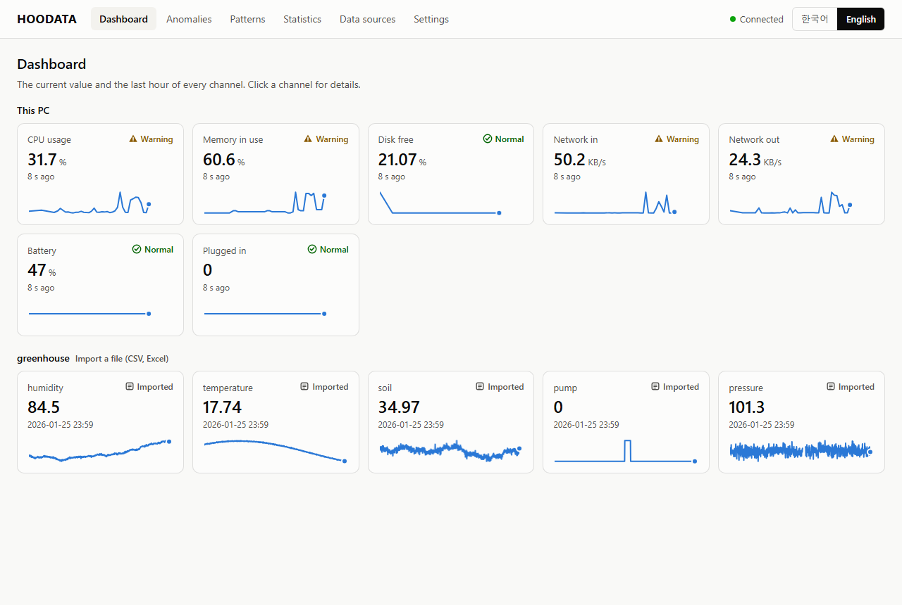
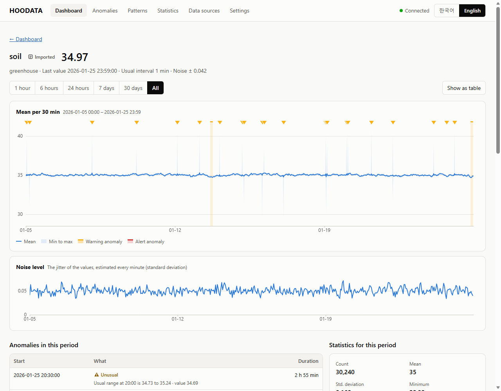
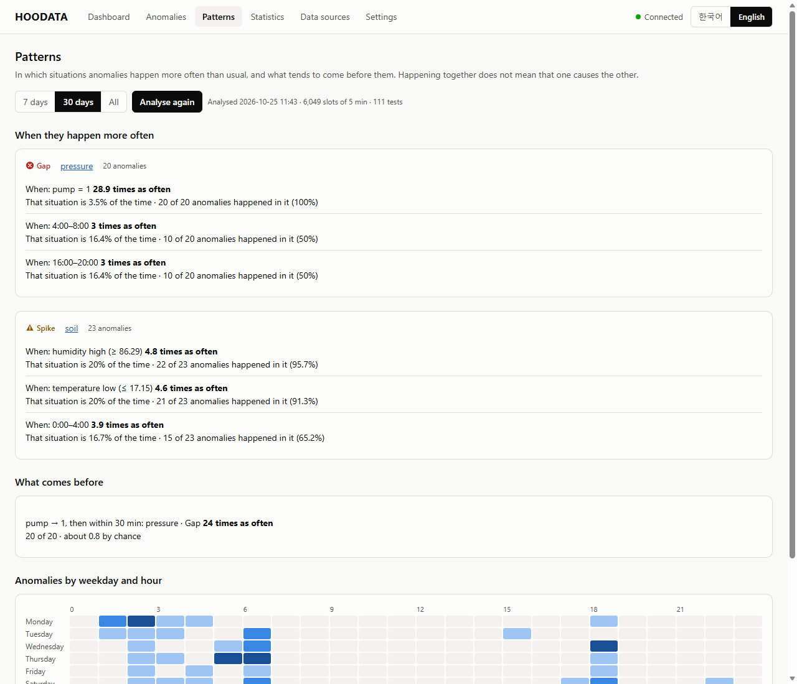

# HOODATA

**Watch every sensor, device and data file in one dashboard, keep a record of noise and anomalies, and find the
situations they happen in.**

Windows 10/11 · nothing to install · everything stays on your PC · [Apache License 2.0](./LICENSE) ·
[한국어](./README.ko.md)

> **In development.** There is no release yet; the version on `main` works and is tested. The plan and progress are
> in [docs/ROADMAP.md](docs/ROADMAP.md) (Korean); how anomalies and patterns are found, and how well, is in
> [docs/METHODS.md](docs/METHODS.md).

<p align="center"></p>

## What it does

- **Collects** from this PC (CPU, memory, disk, network, battery), CSV and Excel files, folders a data logger writes
  to, devices that send over HTTP, MQTT brokers, Modbus TCP devices and serial ports (Arduino text lines, RS-485
  Modbus RTU).
- **Shows** a live dashboard: the current value, status and last hour of every channel; a graph of any period with
  zoom, the noise level, and statistics; every graph also as a table.
- **Records noise and anomalies** in seven kinds: gaps, spikes, level changes, stuck values, values out of the
  limits you set, rising noise, and levels unusual for the time of day. Each comes with the numbers behind it, such
  as "spiked to 41.2 · usual 35.0 · 31 times the usual jitter". Mark the ones that are fine; export the list as CSV.
- **Finds patterns**: in which situations an anomaly happens more often than usual (time of day, weekday, another
  channel high or low, a pump on or off) and what tends to come shortly before it, with the evidence and a test
  against chance.

<p align="center"></p>

It uses well-known statistical methods implemented in this repository, not AI models, so every finding can say why it
was made. A general engine comes first; versions for particular fields (smart farms, fish farms, factory equipment)
will build on it.

## Start

1. Click **Code → Download ZIP**. Before extracting it, right-click the ZIP, choose **Properties**, tick
   **Unblock** and click **OK** (with Smart App Control on, Windows otherwise blocks `start.bat`).
2. Extract it anywhere and double-click **`start.bat`**. A small HOODATA window opens, and the dashboard opens in
   your browser. This PC's own values appear within seconds.
3. Add your data under **Data sources**: drop a CSV or Excel file, or add a device.

HOODATA collects while its window is open; minimised is fine, closing stops it. The data stays in the `data` folder
next to `start.bat` (or in `%LOCALAPPDATA%\HOODATA` when that folder cannot be written). Delete the folder to start
over, or the whole HOODATA folder to remove it.

## Connecting data

| Source | How |
|---|---|
| CSV or Excel file | Drop it on the dashboard. The encoding (UTF-8 or the Windows code page, Korean included), delimiter, header row, time column (also Korean AM/PM, separate date and time columns, seconds since 1970) and units in the header such as `Temp (°C)` are recognised; you can change the choices before importing. |
| Folder | A folder a data logger keeps writing CSV files into. New files and new lines are read every two seconds, and after a restart HOODATA continues where it stopped. |
| HTTP | Devices on your network or programs on this PC send to `http://<this PC>:47110/ingest` with the source's key. The dashboard shows the address, the key and examples for `curl` and the ESP32. |
| MQTT | Subscribes to topics on a broker (TLS and a user name and password if needed). Each topic is a channel; each field of a JSON message is one too. |
| Modbus TCP | Reads a PLC or a meter at a fixed interval by a register table: area, address, 16- or 32-bit integer or float, word order, scale. |
| Serial | Text lines such as `temp:23.5,hum:61` (what an Arduino prints for the Serial Plotter), or Modbus RTU over RS-485. |

Whatever the input, a message can be JSON (`{"temp":23.5,"hum":61}`, nested too, with an optional `ts`),
`name=value` pairs, `name:value` pairs, InfluxDB line protocol, or plain numbers.

An ESP32 sending over HTTP:

```cpp
HTTPClient http;
http.begin("http://192.168.0.10:47110/ingest/greenhouse");
http.addHeader("X-HOODATA-Key", "<the key shown in HOODATA>");
http.POST("temp=" + String(temp) + ",hum=" + String(hum));
http.end();
```

## How well it works

All of this is measured on one Windows 11 laptop and described in [docs/METHODS.md](docs/METHODS.md):

- **Synthetic data with anomalies put in at known times** (temperature, pressure, a machine's current; 185
  channel-days not used for tuning): at the normal sensitivity all 260 anomalies are found, with about 0.05 false
  alarms per channel and day.
- **NAB**, a public benchmark of real server, traffic and machine data: 107 of 116 labelled anomaly windows found,
  but also about 6 other anomalies per 1000 values. Real data has rare but normal bursts that HOODATA reports.
- **The UCR anomaly archive**, mostly the shapes of heartbeats and gaits: 28 of 250 exactly right (11%). HOODATA is
  built for sensor readings that change over seconds to hours, not for the shape of a waveform.
- **Patterns** were checked on three weeks of a synthetic greenhouse with two planted patterns: both were found, and
  nothing was reported for the channel without one.

<p align="center"></p>

## Requirements

- Windows 10 or 11, 64-bit. PowerShell 5.1, WPF and SQLite (`winsqlite3.dll`) are part of Windows; any browser
  shows the dashboard.
- Tested on a Windows 11 laptop only. Serial devices, real MQTT brokers and PLCs were not available: those inputs
  were tested with the stand-ins in `dev/sim` (a small MQTT broker, a Modbus TCP server and an RTU device on an
  in-memory line).

## Privacy and security

- Everything stays on this PC. Nothing is sent anywhere, and nothing is downloaded.
- The dashboard listens on `127.0.0.1` only. It opens with a key that the HOODATA window gives the browser (a
  `HttpOnly`, `SameSite=Strict` cookie); requests that name another host are refused, so another web site cannot reach
  it through a trick DNS name, and changes need a header a web page from elsewhere cannot send.
- The HTTP receiver has its own port and key, and listens beyond this PC only when you allow it. Windows Firewall
  may then ask whether PowerShell may accept connections.
- An MQTT password is stored encrypted for your Windows account (DPAPI) and never shown again.

## Development

```powershell
Invoke-Pester -Path tests                        # Pester 5: engine, API, inputs, detectors, patterns
.\dev\eval\Evaluate-Detectors.ps1                # recall and false alarms on synthetic data
.\dev\eval\Evaluate-Benchmarks.ps1               # NAB and UCR (downloads them once)
```

The engine is C# in `app/engine`, compiled by PowerShell's `Add-Type` when HOODATA starts (C# 5, ASCII-only source
files); the dashboard is plain JavaScript in `app/web`; all visible text is in `app/strings.json`. CI runs the tests
on Windows with GitHub Actions.

## License

[Apache License 2.0](./LICENSE). See [NOTICE](./NOTICE). HOODATA contains no third-party code; it uses the SQLite
that is part of Windows.
